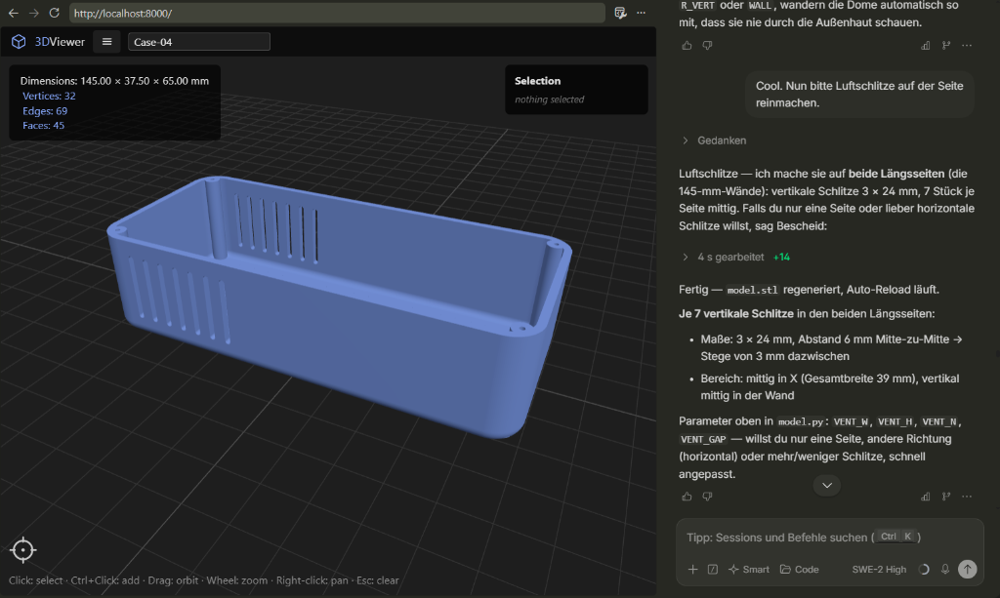
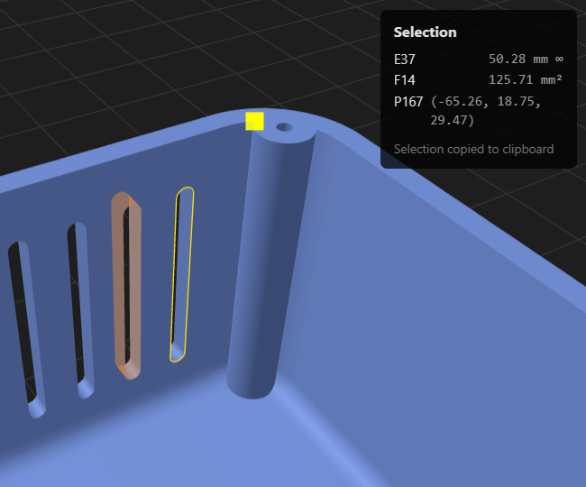

# 3D Vibe Editor

Local STL viewer and parametric CAD workbench. View and inspect STL
files, select vertices/edges/faces with live measurements, and generate
models from Python scripts. Output is watertight binary STL (mm) ready
for the slicer.

Designed for AI-assisted workflows: element selections are copied to
the clipboard as IDs (`E14, F2, P167`) that can be pasted into a chat
to reference model features unambiguously. Agent-facing documentation:
[`AGENTS.md`](AGENTS.md), `.devin/skills/3d-viewer/SKILL.md`.

## Screenshots



*Parametric case model, iterated via AI chat.*


*Organic model generated by an implicit SDF field + marching cubes
(`examples/dragon.py`). Results are coarse compared to sculpting
tools.*



*Vertex, edge and face selection. IDs are copied to the clipboard.*

## Requirements

Python 3.11+

```bat
pip install -r requirements.txt
```

## Usage

```bat
start.bat
```

Starts a local server at http://localhost:8000/ and opens the browser.
Three.js is loaded from CDN; there is no build step.

### Controls

| Input | Action |
|---|---|
| Drag | orbit |
| Wheel | zoom |
| Right-drag | pan |
| Click | select vertex / edge (near cursor) or face |
| Ctrl+Click | add/remove from selection |
| Esc | clear selection |
| Target icon (bottom left) | reset view to grid center |

Selection and hover highlights are rendered through the model, so
internal edges and back faces remain visible. Camera position and
model name persist in `localStorage`.

### Menu (☰)

- **Import STL** — load a local STL file (in-browser only)
- **Export STL** — server-side save dialog; falls back to a browser
  download if the server is unreachable
- **New model** — clear the scene; stays empty until `model.stl` is
  regenerated or a file is imported
- **Deutsch / English** — UI language, persisted

## Model generation

All generators write `model.stl` (gitignored). The viewer polls the
file timestamp every 3 s and reloads on change, keeping the camera.

| Script | Description |
|---|---|
| `model.py` | Starter template (box) — edit for your own project |
| `examples/case.py` | Open-top case with fillets, screw bosses, vent slots (cadquery) |
| `examples/dragon.py` | Dragon head via implicit SDF modeling (skimage marching cubes) |

Parameters sit at the top of each script:

```bat
python model.py
```

`preview.py` renders a headless PNG for verification:

```bat
python preview.py model.stl 12 -60
```

## Project layout

```
index.html            viewer (Three.js, selection, X-ray highlights)
serve.py              local server :8000 (no-cache, save dialog)
start.bat             launches the server
model.py              starter generator
preview.py            headless STL -> PNG renderer
examples/             case.py, dragon.py
docs/                 screenshots
.devin/skills/        agent playbook + chain_report.py (ID resolver)
AGENTS.md             agent workflow notes
```

## Notes

- STL is Z-up; the viewer rotates to Y-up on load (`rotateX(-PI/2)`).
- Element IDs derive from a welded topology (vertex weld + smooth-edge
  union). `chain_report.py` reproduces the same IDs offline.
- `model.stl` missing is a normal state (fresh clone) — the viewer
  shows an empty scene with grid.

## License

MIT — see [LICENSE](LICENSE).
