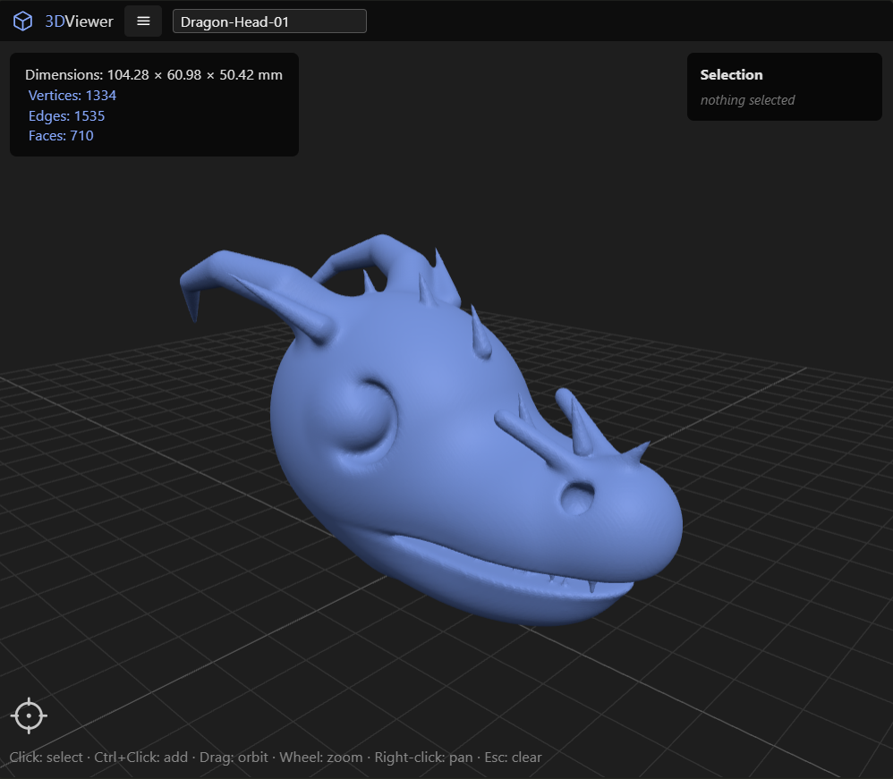

# 3D Viewer — STL viewer & parametric CAD workbench

A self-contained local web app for viewing, inspecting and generating
3D-printable models. Load any STL, click vertices/edges/faces to select
them (with live measurements), and generate models from parametric
Python scripts — output is watertight binary STL in millimeters, ready
for your slicer.

Built for an AI-assisted workflow: the element IDs you select in the
viewer can be pasted straight into a chat so an AI agent knows exactly
which features you mean. See [`AGENTS.md`](AGENTS.md) and
`.devin/skills/3d-viewer/SKILL.md` for the agent playbook.

## Screenshots


*Parametric case model — designed and iterated live with an AI agent.*



*It can do organic shapes too — this dragon head was generated by an
implicit SDF field + marching cubes (`examples/dragon.py`). Just don't
expect sculpting-tool quality: mechanical/parametric work is where it
shines.*

## Quick start

```bat
pip install -r requirements.txt
start.bat
```

`start.bat` launches the local server at http://localhost:8000/ and
opens your browser. No build step — Three.js is loaded from a CDN.

## Viewer controls

| Input | Action |
|---|---|
| Drag | orbit |
| Wheel | zoom |
| Right-drag | pan |
| Click | select vertex / edge (near cursor) or face |
| Ctrl+Click | add/remove from selection |
| Esc | clear selection |
| Target icon (bottom left) | reset view to grid center |

Selection and hover highlights render *through* the model (X-ray), so
inner edges and back faces are visible too. Camera position and model
name persist across reloads (localStorage).

## Menu (☰ burger icon)

- **Import STL** — load any STL file for viewing/selection (in-browser,
  nothing is uploaded)
- **Export STL** — server-side "Save as" dialog (works in browser
  previews and sandboxed iframes where `showSaveFilePicker` fails)
- **New model** — empty scene; stays empty until a new `model.stl`
  is generated or a file is imported
- **Deutsch / English** — UI language toggle (persisted)

The selection is copied to the clipboard as text
(`Kanten: E14, E17`) — paste it into your AI chat to reference
exactly those elements.

## Generating models

Convention: **every generator writes `model.stl`** — one output file,
always overwritten (and gitignored: the repo ships *no* model; a fresh
clone starts with an empty scene). The viewer auto-reloads ~3 s after
the file changes and keeps the camera.

| Script | Model | Technique |
|---|---|---|
| `model.py` | Minimal starter box — your project starts here | trimesh |
| `examples/case.py` | Open-top case: fillets, corner screw bosses, vent slots | cadquery (B-rep) |
| `examples/dragon.py` | Dragon head: horns, teeth, scales, crest | implicit SDF + marching cubes (skimage) |

Edit the parameter block at the top of a script, then run it:

```bat
python model.py            :: or: python examples\dragon.py
```

`python preview.py [file.stl] [elev azim]` renders `_preview.png`
for a quick headless self-check of the result.

## Project structure

```
index.html            viewer (Three.js, selection, X-ray highlights)
serve.py              local server :8000 (no-cache, save dialog)
start.bat             launches the server
model.py              starter generator (edit this for your project)
model.stl             generated output — gitignored, binary, mm, Z-up
preview.py            headless STL -> PNG renderer
examples/case.py      cadquery example (case with fillets/bosses/vents)
examples/dragon.py    organic-shape generator (SDF modeling)
requirements.txt      Python dependencies
AGENTS.md             workflow for AI agents
.devin/skills/        detailed agent playbook + ID resolver
docs/                 screenshots
```

## Tech notes

- STL files are Z-up (CAD standard); the viewer rotates to Y-up on load
- Selection IDs come from a welded topology (vertex weld + smooth-edge
  union); `chain_report.py` reproduces the same IDs offline
- Organic modeling uses signed-distance fields — smooth unions/cuts
  (`smin`/`sdiff`), swept tapered tubes for horns, cones for teeth —
  then marching cubes, so the output is always watertight

## Requirements

Python 3.11+ and the packages in `requirements.txt`
(`pip install -r requirements.txt`).

## License

MIT — see [LICENSE](LICENSE).
